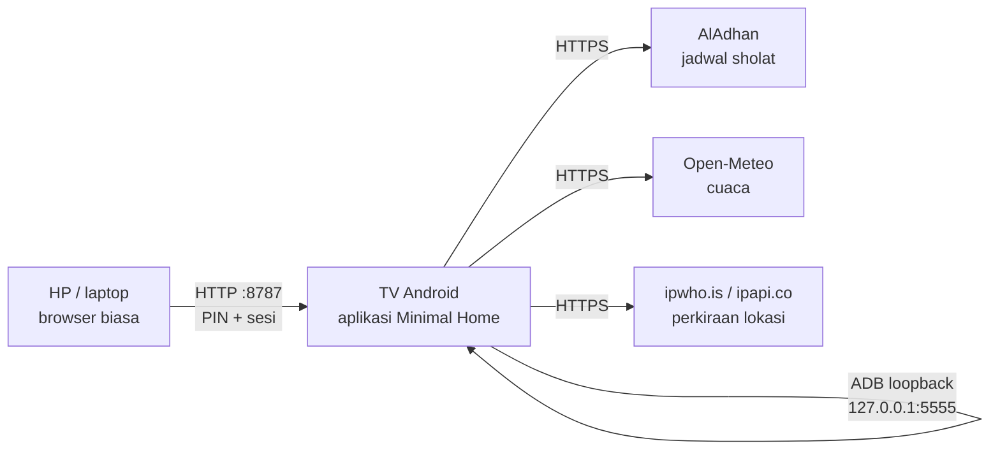

# CleanYourTV Extended

Launcher Android TV minimal dengan **kendali web dari HP atau laptop**: atur susunan Home, ganti
wallpaper, buka aplikasi, tekan tombol remote, kirim teks, ambil tangkapan layar, dan atur
screensaver — semuanya lewat browser di Wi-Fi rumah. Server web berjalan **di dalam TV**, jadi tidak
perlu PC, cloud, root, atau aplikasi tambahan di HP.

> **Kredit proyek asli:** proyek ini merupakan versi extended yang independen dari
> **[CleanYourTV](https://github.com/Gathin23/cleanyourtv)** karya
> **[Gathin23](https://github.com/Gathin23)** (MIT). CleanYourTV adalah panduan dan launcher untuk
> debloat TV dengan aman. Repositori ini **bukan** rilis resmi dan **tidak berafiliasi** dengan
> proyek asli. Selengkapnya di [`ATTRIBUTION.md`](ATTRIBUTION.md).

## Daftar isi

- [Apa ini](#apa-ini)
- [Kredit dan hubungan dengan CleanYourTV](#kredit-dan-hubungan-dengan-cleanyourtv)
- [Fitur](#fitur)
- [Perangkat yang diuji](#perangkat-yang-diuji)
- [Arsitektur](#arsitektur)
- [Prasyarat](#prasyarat)
- [Build dan install](#build-dan-install)
- [Set sebagai Home](#set-sebagai-home)
- [Akses web dari HP](#akses-web-dari-hp)
- [Menyiapkan ADB lokal](#menyiapkan-adb-lokal)
- [Panduan halaman web](#panduan-halaman-web)
- [Screensaver](#screensaver)
- [Data dan privasi](#data-dan-privasi)
- [Keamanan](#keamanan)
- [Troubleshooting](#troubleshooting)
- [FAQ](#faq)
- [Lisensi dan atribusi](#lisensi-dan-atribusi)

## Apa ini

Repo ini berisi satu aplikasi Android untuk TV:

| Bagian | Keterangan |
|---|---|
| **Launcher** | Layar Home minimal: jam, sapaan, cuaca, baris aplikasi, wallpaper, dan pintasan |
| **Server web** | HTTP server yang hidup di dalam aplikasi TV, default port `8787` |
| **Kendali web** | SPA tanpa framework di browser HP: layout, remote, aplikasi, layar, setelan |
| **Screensaver** | Jadwal sholat, catatan, atau to-do list yang tampil saat TV diam |
| **ADB lokal** | Koneksi ke `127.0.0.1:5555` milik TV sendiri untuk tombol remote dan tangkapan layar |

Nama teknis yang muncul di TV adalah **Minimal Home** (`com.raafi.cyberhome`). Antarmuka web memakai
brand **CyberHome v2.2**. Nama repositori, **CleanYourTV Extended**, adalah nama proyek dan bentuk
penghormatan kepada proyek aslinya.

Yang **tidak** dilakukan aplikasi ini: tidak melakukan root, tidak menghapus atau menonaktifkan
aplikasi sistem, tidak mengubah firmware, dan tidak mengirim data ke cloud. Untuk debloat, gunakan
prosedur dan aturan keamanan dari [CleanYourTV asli](https://github.com/Gathin23/cleanyourtv).

## Kredit dan hubungan dengan CleanYourTV

- **Proyek asli:** <https://github.com/Gathin23/cleanyourtv>
- **Pembuat proyek asli:** [Gathin23](https://github.com/Gathin23)
- **Lisensi proyek asli:** MIT, disalin di [`licenses/CleanYourTV-MIT.txt`](licenses/CleanYourTV-MIT.txt)

CleanYourTV asli berfokus pada panduan debloat yang aman, daftar TV yang sudah diuji, dan launcher
minimal. Repo ini memperluas ide tersebut menjadi **launcher + remote web + screensaver** yang
berdiri sendiri. Tidak ada source Java dari launcher asli yang disalin; implementasi di repo ini
ditulis terpisah. Satu aset yang sama adalah font **Outfit**, yang memang berlisensi OFL dan boleh
dipakai ulang dengan atribusi.

Jika kamu ingin membersihkan TV dari aplikasi bawaan, ikuti `PROMPT.md` di repo asli dan patuhi
aturan keselamatannya. Jangan mencampur langkah debloat ke repo ini tanpa memahami risikonya.

## Fitur

### Launcher

- Home minimal untuk Android TV, orientasi landscape.
- Jam, sapaan, tanggal, cuaca, dan chip status.
- Grid aplikasi yang bisa diatur kolom, ukuran ikon, label, jarak, dan margin.
- Sembunyikan aplikasi dari Home tanpa meng-uninstall-nya, dan ubah urutannya.
- Wallpaper sendiri, warna aksen, tema otomatis/terang/gelap, serta beberapa pintasan.

### Kendali web

- **Beranda:** pratinjau layar TV, tombol cepat, D-pad, media, volume, teks, dan tombol daya.
- **Remote:** D-pad, OK, Back, Home, Menu, Info, Search, kontrol pemutaran, dan keyboard virtual.
  Saat halaman Remote aktif, tombol panah, Enter, Esc, dan spasi di keyboard HP juga mengendalikan TV.
- **Layout:** semua pengaturan tampilan Home dengan pratinjau dan penyimpanan otomatis.
- **Aplikasi:** cari aplikasi, buka, lihat info, sembunyikan dari Home, dan ubah urutan.
- **Layar:** pilih dan atur screensaver, termasuk catatan dan to-do list.
- **Setelan:** alamat server, ganti port, ganti PIN, status ADB, dan restart server.

### Screensaver

- Tiga mode, pilih **satu** yang aktif: **Jadwal sholat**, **Catatan**, atau **To-do list**.
- Jadwal sholat, hitung mundur, dan tanggal Hijriah.
- Catatan dan to-do list dibuat/diedit langsung dari web; perubahan langsung terlihat di TV.
- Jam dan tanggal bisa dinyalakan/dimatikan.

### Keamanan dasar

- Login PIN 6 angka yang dibuat otomatis dan disimpan di TV.
- Sesi 7 hari, cookie `HttpOnly`, batas percobaan login, dan invalidasi sesi saat PIN diganti.
- Hanya menerima koneksi dari alamat jaringan privat; bukan untuk internet publik.
- Tanpa akun, analytics, iklan, atau telemetry.

## Perangkat yang diuji

| | |
|---|---|
| TV | Xiaomi Mi TV 4A 32" (`MiTV-AESP0`, codename `aquaman`) |
| Sistem | Android TV 9 / API 28 |
| Layar | 1920 × 1080, density 320 |
| Status | Launcher, remote web, screensaver, dan CRUD catatan/to-do diuji langsung di TV ini |

Aplikasi memakai `minSdk 26` (Android 8.0) dan `targetSdk 34`. Perangkat Android TV lain **belum
diuji**. Google TV, merek lain, dan firmware yang berbeda bisa punya menu developer, perilaku ADB,
atau pembatasan Home yang berbeda.

## Arsitektur



Tidak ada server perantara. Browser berbicara langsung ke TV di jaringan lokal, dan TV memakai ADB
ke dirinya sendiri untuk hal-hal yang butuh izin sistem, seperti mengirim keyevent dan mengambil
screenshot.

## Prasyarat

### Untuk memakai

- TV Android dengan Android 8.0+ dan akses ke menu pengembang/ADB.
- HP atau laptop dengan browser modern, terhubung ke **Wi-Fi yang sama** dengan TV.
- Koneksi internet di TV untuk jadwal sholat, cuaca, dan perkiraan lokasi.
- Remote TV untuk menerima dialog izin ADB pertama kali.

### Untuk build

- JDK 17.
- Android SDK Platform 34 dan Build Tools 34.0.0.
- Android Studio (opsional) atau Gradle wrapper yang sudah disertakan.
- `adb` dari Android SDK Platform-Tools untuk memasang APK.

## Build dan install

Repo ini hanya berisi source; tidak ada APK yang di-commit dan tidak ada build yang ditandatangani
untuk distribusi publik.

### Lewat Android Studio

1. Buka folder repo ini di Android Studio.
2. Tunggu Gradle sync selesai (AGP 8.5.2, Gradle 8.9).
3. Sambungkan TV lewat ADB, lalu klik **Run**.

### Lewat terminal

macOS / Linux:

```bash
export JAVA_HOME="/path/ke/jdk-17"
export ANDROID_HOME="$HOME/Android/Sdk"       # sesuaikan
./gradlew assembleDebug
```

Windows PowerShell:

```powershell
$env:JAVA_HOME = "C:\Program Files\Java\jdk-17"
$env:ANDROID_HOME = "$env:LOCALAPPDATA\Android\Sdk"
.\gradlew.bat assembleDebug
```

APK debug ada di:

```text
app/build/outputs/apk/debug/app-debug.apk
```

Pasang ke TV:

```bash
adb connect <IP-TV>:5555      # jika network debugging sudah aktif
adb install -r app/build/outputs/apk/debug/app-debug.apk
```

`local.properties` tidak disertakan. Android Studio membuatnya otomatis; untuk build CLI, gunakan
variabel `ANDROID_HOME` atau buat `local.properties` berisi `sdk.dir=...` (jangan di-commit).

### Build release

```bash
./gradlew assembleRelease
```

APK release ada di `app/build/outputs/apk/release/app-release.apk`. **Penting:** konfigurasi release
saat ini masih memakai debug signing key (`signingConfig signingConfigs.debug`), jadi jangan
mendistribusikan APK tersebut sebagai build produksi. Untuk pemakaian pribadi di TV sendiri, build
ini bisa dipakai; untuk rilis publik, buat keystore sendiri dan jangan commit keystore itu.

## Set sebagai Home

Setelah APK terpasang:

1. Tekan tombol **Home** di remote TV.
2. Pilih **Minimal Home**, lalu **Always** / **Selalu**.
3. Jika pemilih tidak muncul, buka **Setelan → Aplikasi → Aplikasi default → Aplikasi Home**, lalu
   pilih **Minimal Home**.

Aplikasi ini adalah launcher biasa, bukan aplikasi sistem. Jika ingin kembali ke launcher bawaan,
pilih launcher bawaan di menu Home app atau uninstall **Minimal Home**. Launcher bawaan tidak
dinonaktifkan oleh aplikasi ini.

## Akses web dari HP

Ini adalah cara utama memakai proyek ini.

### Langkah cepat

1. Pastikan TV dan HP terhubung ke **Wi-Fi rumah yang sama**. Hindari Wi-Fi tamu yang mengisolasi
   perangkat.
2. Di Home TV, pilih chip **Web** di bar atas. Bisa juga dengan menekan tombol **MENU** atau
   **INFO** di remote.
3. Kartu **Kendali web** akan menampilkan:
   - **Alamat** contohnya `http://192.168.1.50:8787`
   - **PIN** 6 angka
4. Buka alamat tersebut di browser HP. Tidak perlu install aplikasi.
5. Masukkan PIN 6 angka.
6. Setelah masuk, pilih halaman lewat sidebar (desktop) atau navigasi bawah (HP):
   **Beranda, Remote, Layout, Layar, Aplikasi, Setelan**.

Alamat dan PIN juga muncul di notifikasi foreground **"Kendali web aktif"** selama server berjalan.

### Detail yang perlu diketahui

- **Port default `8787`.** Jika port itu sedang dipakai, aplikasi mencoba port berikutnya (sampai
  `8796`) dan menyimpan port yang berhasil. Selalu pakai alamat yang ditampilkan di TV, bukan
  menebak sendiri.
- **Ganti port** lewat **Setelan → Server lokal → Ganti port server** (1024–65535). Setelah server
  restart, buka alamat baru yang muncul.
- **Sesi 7 hari.** Sesi disimpan di memori TV; restart aplikasi atau TV akan meminta PIN lagi. PIN
  tetap tersimpan.
- **Ganti PIN** lewat **Setelan → Keamanan**. Perangkat lain yang sudah login akan dikeluarkan.
  Tombol **PIN baru** di kartu Web TV juga mengeluarkan semua sesi.
- **Lupa PIN?** Buka chip Web di TV. PIN selalu terlihat di sana.
- **Logout** lewat tombol **Keluar** di sidebar.
- **Alamat TV berubah** setelah reboot kalau DHCP memberi alamat baru. Baca alamat terbaru di kartu
  Web, atau pasang DHCP reservation di router agar tetap.
- **Hanya jaringan lokal.** Server menolak alamat klien publik. Kalau HP memakai VPN, koneksi bisa
  ditolak; matikan VPN saat mengakses TV.
- **Jangan buka port TV ke internet.** Jangan lakukan port forwarding untuk `8787` atau `5555`.
  Halaman ini memakai HTTP biasa, tanpa TLS.

### Kalau alamat tidak bisa dibuka

| Gejala | Yang dicek |
|---|---|
| Halaman tidak memuat | HP dan TV harus di subnet/VLAN yang sama; Wi-Fi tamu sering memisahkan klien |
| Alamat berubah | Lihat kartu Web/notifikasi TV; alamat bisa berubah setelah reboot |
| Server belum aktif | Buka aplikasi **Minimal Home** di TV, atau buka/tutup kartu Web; server berjalan lewat foreground service |
| Port 8787 dipakai | Cek alamat aktual di TV (bisa 8788–8796) atau ganti port di Setelan |
| Login ditolak | Pastikan PIN terbaru dari kartu Web; tunggu 5 menit jika terlalu banyak percobaan |
| TV baru dimatikan penuh | Nyalakan TV dengan remote; server tidak bisa diakses saat TV benar-benar mati |

## Menyiapkan ADB lokal

ADB **tidak dibutuhkan** untuk mengubah layout, menyembunyikan aplikasi, mengganti wallpaper, atau
mengatur screensaver. ADB dibutuhkan untuk:

- tombol remote, D-pad, media, dan volume;
- mengirim teks dari keyboard web;
- pratinjau layar dan tangkapan layar;
- tombol daya, tidur, dan bangun (tergantung dukungan TV).

Aplikasi terhubung ke **ADB milik TV sendiri** di `127.0.0.1:5555`. Karena itu tidak perlu PC yang
menjadi jembatan setelah aplikasi terpasang.

### Langkah

1. Di TV, buka **Setelan → Tentang** (About) dan ketuk **Build** 7 kali sampai opsi pengembang aktif.
2. Buka **Setelan → Preferensi perangkat → Opsi pengembang**.
3. Aktifkan **USB debugging** dan, jika tersedia, **Network debugging** / **ADB over network**.
   Port yang dipakai adalah `5555`.
4. Kembali ke web, buka **Beranda → ADB lokal → Sambungkan ADB**, atau **Setelan → ADB lokal**.
5. Dialog **"Allow USB debugging?"** akan muncul di TV. Pilih **Always allow from this computer**,
   lalu **OK** dengan remote.
6. Tekan **Sambungkan** / **Periksa** lagi jika status belum berubah.

Jika dari PC `adb connect <IP-TV>:5555` berhasil, artinya port ADB TV sudah terbuka dan aplikasi
biasanya juga bisa memakainya.

### Catatan ADB

- Kunci RSA dibuat oleh aplikasi dan disimpan di penyimpanan privat aplikasi. Jangan pernah
  membagikan atau meng-commit kunci ini.
- Pernah menolak dialog? Ulangi langkah koneksi; dialog akan muncul lagi.
- Beberapa TV hanya punya **USB debugging** dan tidak membuka TCP 5555. Di model seperti itu,
  remote web berbasis ADB tidak akan berfungsi tanpa opsi network debugging.
- Port `5555` adalah koneksi plaintext dan sangat kuat. Setelah selesai, matikan network debugging
  dan cabut autorisasi ADB dari menu pengembang.
- Aplikasi tidak memakai ADB untuk uninstall, root, atau mengubah paket sistem.

## Panduan halaman web

### Beranda

- **Pratinjau layar** menampilkan kondisi TV saat ini; butuh ADB.
- **Tombol cepat:** Home, Kembali, Play/Pause, dan Tangkapan layar.
- **Pintasan:** Setelan Android, Wi-Fi, daftar aplikasi, dan wallpaper.
- **Daya:** pilihan tidur/bangun, serta tombol daya jika didukung TV.
- **D-pad dan media:** navigasi dan kontrol pemutaran.
- **Kirim teks:** fokuskan kolom input di TV, lalu kirim dari web. Teks yang didukung adalah karakter
  Latin sederhana (ASCII), maksimal 500 karakter.

### Remote

Halaman khusus remote dengan D-pad, OK, Back, Home, Menu, Info, Search, volume, mute, dan kontrol
media. Saat halaman ini aktif, keyboard HP juga bisa dipakai: panah, Enter, Esc, dan spasi.

### Layout

- Tema **Otomatis / Terang / Gelap**.
- Warna aksen.
- Kolom grid 3–8, ukuran ikon 28–64, ukuran label 8–18, tinggi baris, jarak, dan margin.
- Nama sapaan (maksimal 24 karakter), jam, tanggal, cuaca, tombol mode, chip Web, setelan, dan akun.
- Tampilkan/sembunyikan label aplikasi dan efek glow.
- Unggah wallpaper **JPG, PNG, atau WebP**, minimal 320 × 180, maksimal 7680 × 4320 dan 14 MB.
- Pratinjau mengikuti perubahan; pengaturan disimpan otomatis.

### Aplikasi

- Daftar aplikasi yang bisa dibuka dari Home.
- Cari aplikasi, buka aplikasi, atau buka halaman info aplikasi.
- Sembunyikan aplikasi dari Home tanpa meng-uninstall-nya.
- Ubah urutan dengan drag atau tombol panah. Urutan ini sama dengan yang tampil di TV.

### Layar

Halaman untuk mengatur screensaver. Lihat bagian [Screensaver](#screensaver).

### Setelan

- **Server lokal:** alamat aktif, status, waktu mulai, dan ganti port.
- **ADB lokal:** status dan tombol sambung.
- **Keamanan:** ganti PIN 6 angka.
- **Reset layout** dan pengaturan lain yang tersedia di halaman.

## Screensaver

Screensaver adalah fitur Android Dream. Aplikasi menyediakan layanan bernama
**Screensaver CyberHome** (`com.raafi.cyberhome/.PrayerDreamService`).

### Mode

Pilih **satu** mode aktif di halaman **Layar**:

| Mode | Isi |
|---|---|
| **Jadwal sholat** | Nama lokasi, jadwal sholat, hitung mundur, dan tanggal Hijriah |
| **Catatan** | Enam catatan teratas; judul dan isi ringkas |
| **To-do list** | Delapan tugas teratas dengan progres penyelesaian |

Jam dan tanggal bisa dinyalakan atau dimatikan untuk semua mode.

### Batas data

| Data | Batas |
|---|---|
| Catatan | 30 catatan; judul 80 karakter; isi 600 karakter; 6 teratas tampil |
| To-do | 60 tugas; teks 160 karakter; 8 teratas tampil; tugas belum selesai tampil lebih dulu |
| Wallpaper | 14 MB; minimal 320 × 180; maksimal 7680 × 4320 |

Perubahan disimpan otomatis ke TV. Saat screensaver sedang berjalan, perubahan dari web langsung
diterapkan tanpa perlu menutup screensaver.

### Mengaktifkan screensaver

1. Buka halaman **Layar** di web.
2. Pilih mode dan isi datanya.
3. Tekan tombol untuk membuka **setelan screensaver TV** (halaman ini membuka Setelan Dream Android).
4. Pilih **Screensaver CyberHome** sebagai screensaver.
5. Atur waktu tunggu (misalnya 15/30/60 menit) sesuai menu TV.

Android yang memakai screensaver pihak ketiga akan menampilkan layanan ini selama aplikasi masih
terpasang. Jika TV memakai screensaver bawaan, pilih layanan ini secara manual dari Setelan TV.

### Lokasi dan jadwal sholat

- Jadwal sholat memakai **AlAdhan API** dengan metode `20` (Kemenag).
- Cuaca memakai **Open-Meteo**.
- Perkiraan lokasi diambil dari **alamat IP publik TV** lewat `ipwho.is`, dengan fallback
  `ipapi.co`. Tidak ada pengaturan kota manual.
- Karena lokasi berasal dari IP, VPN, CGNAT, atau IP publik yang salah bisa membuat kota dan jadwal
  tidak akurat. Ini keterbatasan yang diketahui, bukan bug layout.

## Data dan privasi

### Yang disimpan di TV

| Data | Lokasi |
|---|---|
| PIN dan port server | `SharedPreferences` privat aplikasi |
| Layout Home, wallpaper | Penyimpanan privat aplikasi |
| Catatan dan to-do | `screensaver.json` di penyimpanan privat aplikasi |
| Kunci ADB | Folder privat aplikasi (`files/adb/`) |

Semua data ini hilang jika aplikasi di-uninstall (kecuali kamu membackup-nya sendiri). Aplikasi
memakai `allowBackup="false"`, jadi data tidak ikut backup otomatis Android.

### Yang dikirim keluar

| Tujuan | Data | Kapan |
|---|---|---|
| `api.aladhan.com` | Tanggal, koordinat perkiraan | Saat mengambil jadwal sholat |
| `api.open-meteo.com` | Koordinat perkiraan | Saat mengambil cuaca untuk Home |
| `ipwho.is`, `ipapi.co` | Alamat IP publik TV | Saat memperkirakan lokasi |

Tidak ada server milik proyek ini. Tidak ada akun, analytics, advertising, atau crash reporting.
Untuk jadwal sholat dan cuaca di Home, TV perlu internet. Mode catatan dan to-do tetap bekerja
tanpa internet.

## Keamanan

Proyek ini dirancang untuk **jaringan rumah yang dipercaya**, bukan untuk internet publik.

- **Jangan port-forward** `8787` atau `5555` ke internet. Halaman web memakai HTTP tanpa TLS.
- **Jangan pakai Wi-Fi tamu** yang mengisolasi klien atau yang bisa diakses orang luar.
- Siapa pun di LAN yang tahu PIN bisa mengendalikan TV. Ganti PIN jika bocor.
- PIN hanya disimpan di TV. Sesi disimpan di memori, bukan di browser sebagai token yang bisa
  dibaca JavaScript.
- Server membatasi request ke alamat privat/loopback/link-local/CGNAT/ULA, memakai cookie sesi,
  header `X-Cyber-Client`, dan pengecekan origin untuk request yang mengubah state.
- Batas 8 percobaan login gagal per alamat dalam 5 menit.
- ADB port `5555` adalah plaintext. Aktifkan hanya saat dibutuhkan, lalu matikan network debugging.
- Build release saat ini memakai debug signing key; jangan pasang APK dari sumber yang tidak kamu
  percaya.

Panduan pelaporan masalah keamanan ada di [`SECURITY.md`](SECURITY.md).

## Troubleshooting

### Web tidak bisa dibuka

- Pastikan HP dan TV di Wi-Fi/subnet yang sama, bukan jaringan tamu dengan client isolation.
- Cek alamat di kartu Web atau notifikasi TV; port bisa berpindah ke 8788–8796.
- Buka ulang aplikasi **Minimal Home** agar foreground service dan server hidup.
- Matikan VPN di HP; VPN bisa membuat request dianggap bukan dari jaringan lokal.
- Cek apakah TV masih menyala dan terhubung Wi-Fi.
- TV perlu alamat IPv4 LAN; jaringan IPv6-only belum didukung oleh pemilihan alamat server.

### PIN salah atau login terus diminta

- Baca PIN terbaru di kartu Web TV (chip **Web** atau tombol **MENU**).
- Setelah aplikasi/TV restart, sesi lama hilang dan PIN diminta lagi. Ini normal.
- Jika terlalu banyak percobaan gagal, tunggu 5 menit.
- Ganti PIN dari Setelan jika perlu; semua perangkat lain harus login ulang.

### ADB tidak tersambung

- Aktifkan opsi pengembang, **USB debugging**, dan **Network debugging/ADB over network**.
- Pastikan port `5555` terbuka di TV. Uji dari PC dengan `adb connect <IP-TV>:5555`.
- Terima dialog izin ADB di TV, centang **Always allow**, lalu tekan **Periksa** lagi.
- Beberapa TV tidak membuka ADB TCP; remote berbasis ADB tidak akan bekerja di model tersebut.
- Setelah update firmware atau revoke authorization, dialog izin perlu diterima ulang.

### Remote atau screenshot tidak bereaksi

- Tekan bagian remote untuk melihat status ADB. Jika belum tersambung, sambungkan dulu.
- Tombol daya/tidur/bangun tidak selalu didukung semua TV.
- Screenshot bisa kosong untuk konten berproteksi DRM, live TV, atau HDMI tertentu; itu batasan
  perangkat, bukan kerusakan aplikasi.
- Teks non-ASCII ditolak; gunakan huruf Latin sederhana.

### Screensaver tidak muncul

- Pastikan **Screensaver CyberHome** dipilih di Setelan layar/screensaver TV.
- Atur waktu tunggu screensaver agar TV benar-benar masuk mode dream.
- Beberapa TV menonaktifkan screensaver saat ada aplikasi video berjalan.
- Jika mode sholat tidak menampilkan data, periksa internet TV dan akurasi lokasi dari IP.

### Jadwal sholat atau cuaca salah kota

- Lokasi berasal dari IP publik TV, bukan GPS. VPN atau IP dinamis dapat mengubahnya.
- Saat ini belum ada pengaturan kota manual.
- Ganti jaringan/VPN atau tunggu cache lokasi diperbarui.

### Build gagal

- Pastikan JDK 17 dipakai (`java -version`), bukan JDK 8/11/21 yang tidak kompatibel dengan AGP
  8.5.2.
- Pastikan SDK Platform 34 dan Build Tools 34.0.0 terpasang.
- Hapus `local.properties` jika path SDK mengarah ke komputer lain, lalu buka ulang di Android Studio
  atau set `ANDROID_HOME`.
- Jalankan `./gradlew --no-daemon clean assembleDebug` untuk build bersih.

## FAQ

**Apakah perlu root?**
Tidak. Aplikasi memakai API Android biasa dan ADB loopback. Tidak ada root, flashing, atau uninstall
paket sistem.

**Apakah ini sama dengan CleanYourTV?**
Tidak. Ini proyek terpisah yang terinspirasi darinya. Untuk debloat, ikuti CleanYourTV asli.

**Bisa dipakai di merek TV lain?**
Mungkin, selama Android 8.0+ dan Home/ADB-nya bisa diakses. Baru diuji pada satu model Xiaomi; fitur
Home, screensaver, dan ADB sangat bergantung pada firmware.

**Apakah butuh internet?**
Untuk membuka web dan mengatur layout, tidak. Internet dibutuhkan untuk jadwal sholat, cuaca, dan
perkiraan lokasi.

**Apakah data catatan saya masuk cloud?**
Tidak. Catatan dan to-do hanya tersimpan di penyimpanan privat aplikasi di TV.

**Bisa diakses dari luar rumah?**
Tidak, dan jangan dipaksakan. Server hanya untuk LAN dan memakai HTTP biasa. Gunakan VPN rumah yang
aman jika benar-benar perlu akses jarak jauh (di luar cakupan proyek ini).

**Mengapa nama aplikasi di TV "Minimal Home"?**
Itu nama teknis yang sudah dipakai pada build yang diuji. Nama proyek/repo tetap CleanYourTV
Extended, dan brand web-nya CyberHome.

**Apakah ada APK siap pakai?**
Tidak ada APK di repo. Build sendiri dari source. Build release masih debug-signed; jangan
mendistribusikannya sebagai APK resmi.

## Lisensi dan atribusi

- Kode proyek ini: **MIT**, lihat [`LICENSE`](LICENSE).
- Proyek asli **CleanYourTV** oleh **Gathin23**: MIT, lihat
  [`licenses/CleanYourTV-MIT.txt`](licenses/CleanYourTV-MIT.txt).
- **NanoHTTPD** 2.3.1: BSD-3-Clause.
- **Dadb** 2.0.0: Apache-2.0.
- **Outfit** font: SIL Open Font License 1.1, Copyright 2021 The Outfit Project Authors.

Detail lengkap ada di [`ATTRIBUTION.md`](ATTRIBUTION.md) dan
[`THIRD_PARTY_NOTICES.md`](THIRD_PARTY_NOTICES.md).

## Disclaimer

Proyek ini eksperimental dan disediakan **tanpa jaminan**. Mengubah launcher, mengaktifkan ADB,
atau memasang aplikasi pihak ketiga di TV selalu punya risiko. Kamu bertanggung jawab atas
perangkatmu. Jangan mengikuti langkah debloat dari proyek mana pun tanpa membaca aturan keamanan dan
tanpa backup. Proyek ini tidak berafiliasi dengan Xiaomi, Google, CleanYourTV, atau merek lain yang
disebut.

---

## English summary

CleanYourTV Extended is an independent Android TV launcher with a web-based remote. The HTTP server
runs on the TV itself; a phone on the same Wi-Fi opens `http://<tv-ip>:8787`, enters the 6-digit PIN
shown on the TV, and can manage the Home layout, apps, wallpaper, remote keys, screenshots, and the
screensaver (prayer times, notes, or to-dos). It requires no root, cloud account, or PC.

It is inspired by [CleanYourTV](https://github.com/Gathin23/cleanyourtv) by
[Gathin23](https://github.com/Gathin23) (MIT) and is not an official or endorsed release. See
[`ATTRIBUTION.md`](ATTRIBUTION.md). The app is tested on a Xiaomi Mi TV 4A 32" (Android TV 9); other
devices are untested. The web UI is HTTP-only and must stay on a trusted LAN — never expose ports
`8787` or `5555` to the internet.
